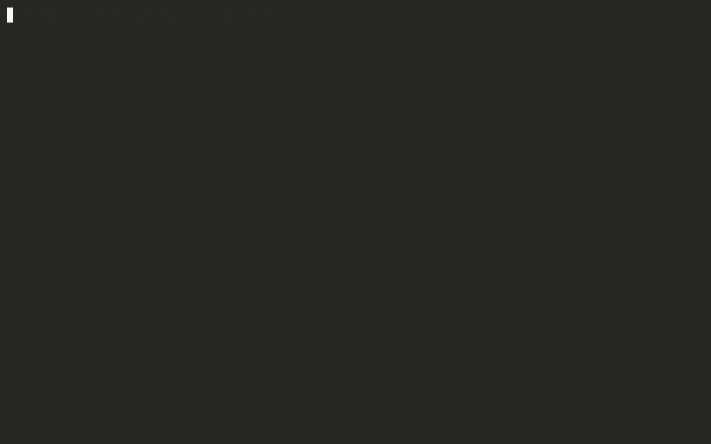

# OpenStack Serial Console

## Introduction
This small tool will help you connect on an instance using **Serial Console** instead of SSH.
This can be useful when your instance is not accessible from network.

This is pretty much the same as using the Web Console, but using a cli tool is always easier for sysadmins.


## Configuration on OpenStack side
Before using this tool, you must configure your OpenStack to display Serial Console.
This can be done by following this link:
https://docs.openstack.org/nova/latest/admin/remote-console-access.html#serial

## Install
### Download pre-compiled binary
See here: https://github.com/arnaudmorin/osconsole/releases/latest
```
wget https://github.com/arnaudmorin/osconsole/releases/download/0.0.3/osconsole
```

### Build from sources
You can build from sources:
```
git clone https://github.com/arnaudmorin/osconsole.git
bash build.sh
```

## Usage
Before using **osconsole**, you must request a **Serial over WebSocket** URL for your instance against your OpenStack:

```
openstack console url show --serial myserver
# or
# nova get-serial-console
```

The, just copy/paste this URL to osconsole:

```
osconsole 'ws://51.89.5.214:6083/?token=2e1ba41d-61f2-4b3e-a26d-777fdb56665d'
+-----------------------------------------+ 
|Connected. Type "Ctrl+[ d" to disconnect.| 
+-----------------------------------------+ 

login as 'cirros' user. default password: 'gocubsgo'. use 'sudo' for root.
n1 login:
```

You are now connected!

## Using the VNC console (experimental)
When the serial console is not enabled on your cloud, **osconsole** can also
use the noVNC console. The VNC protocol only carries pixels, so osconsole
recognizes the characters drawn on the screen by matching them against font
bitmaps: the QEMU VGA BIOS font (embedded, see [fonts](fonts/README.md)) and
the Linux console fonts installed on your machine (packages `console-setup`
or `kbd`), in case the instance loads one of them. It works when the
instance shows a text console (VGA text mode, or the kernel framebuffer
console), not a graphical desktop.



```
osconsole "$(openstack console url show --novnc -f value -c url myserver)"
```

The remote screen is mirrored in your terminal (no scrollback), keystrokes
are sent as VNC key events assuming a US keyboard layout on the instance.

Grab the screen as text, for scripts:

```
osconsole -screenshot 'http://51.89.5.214:6080/vnc_lite.html?path=%3Ftoken%3D...'
osconsole -screenshot -type 'root\r' -wait 3s 'http://...'
```

If characters show up as `�`, the instance uses a console font you do not
have locally: pass it with `-font /path/to/font.psf.gz` (can be repeated,
globs accepted).

## Authors
This project has been inspired from:
https://github.com/hironobu-s/novassh

Original author: Hironobu Saitoh - [hiro@hironobu.org](mailto:hiro@hironobu.org)

osconsole author: Arnaud Morin - [arnaud.morin@gmail.com](mailto:arnaud.morin@gmail.com)

